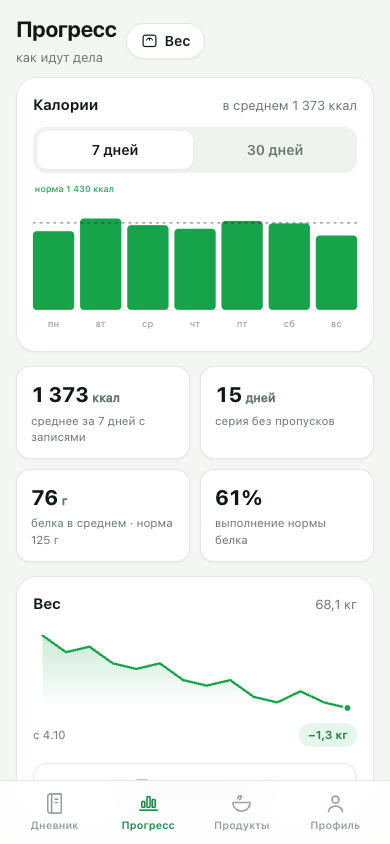
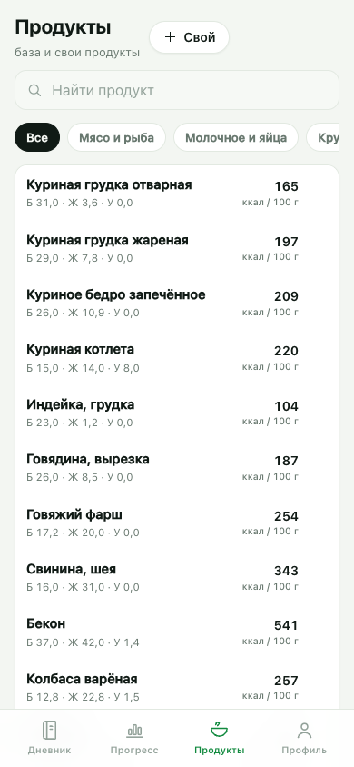

# Норма — дневник калорий

Простой дневник питания как PWA: считает норму калорий и БЖУ, помогает записывать еду и следить за весом. Работает офлайн, ставится на телефон с домашнего экрана, данные хранятся только на устройстве.

**Демо:** https://abaginskii.github.io/norm-calories/

<p align="center">
  
  
  
</p>

## Возможности

- **Дневник по дням** — завтрак, обед, ужин и перекус, переход между днями стрелками.
- **Кольцо калорий и БЖУ** — видно, сколько съедено, сколько осталось и как выполнены цели по белкам, жирам и углеводам.
- **База продуктов** — 138 позиций на 100 г: мясо, рыба, крупы, овощи, фрукты, готовые блюда, соусы.
- **Свои продукты** — можно добавить любое блюдо с калорийностью и БЖУ.
- **Поиск, недавние и избранное** — чтобы не искать одно и то же каждый день.
- **Граммы и порции** — ввод в граммах со степпером и быстрыми кнопками 50/100/150/200/250 г, пересчёт в реальном времени.
- **Быстрое добавление калорий** — для еды вне дома, когда продукта нет в базе.
- **Норма по формуле** Миффлина — Сан Жеора с поправкой на активность и цель (похудение / поддержание / набор), с ручной корректировкой.
- **Вес и динамика** — запись веса, график, изменение за период, ИМТ.
- **Статистика** — калории за 7 или 30 дней, средние БЖУ, серия дней без пропусков.
- **Тёмная и светлая темы**, в том числе автоматически как в системе.
- **Экспорт и импорт** резервной копии в JSON.
- **Офлайн** — после первого открытия приложение работает без интернета.

## Как считается норма

1. Базовый метаболизм по формуле Миффлина — Сан Жеора:
   - мужчины: `10 × вес + 6,25 × рост − 5 × возраст + 5`
   - женщины: `10 × вес + 6,25 × рост − 5 × возраст − 161`
2. Умножение на коэффициент активности (1,2–1,9).
3. Поправка на цель: дефицит или профицит из расчёта ~7700 ккал на килограмм, но не ниже безопасного минимума (1200 ккал для женщин, 1500 для мужчин).
4. БЖУ: белок 1,6–2 г на кг веса, жиры 20–35 % калорий, углеводы — остаток.

Это ориентир для самоконтроля, а не медицинская рекомендация.

## Установка на телефон

**Android / Chrome:** меню браузера (⋮) → «Установить приложение» или «Добавить на главный экран».

**iPhone / Safari:** «Поделиться» → «На экран „Домой“».

После установки приложение открывается без адресной строки и работает офлайн.

## Локальный запуск

Сборка не нужна — это статические файлы. Достаточно любого статического сервера:

```bash
git clone https://github.com/abaginskii/norm-calories.git
cd norm-calories
python3 -m http.server 8000
```

Откройте http://localhost:8000. Открывать `index.html` напрямую из файловой системы нельзя: ES-модули и service worker требуют http(s).

## Структура

```
index.html            — разметка оболочки
styles.css            — дизайн-токены и все стили
manifest.webmanifest  — манифест PWA
sw.js                 — service worker (офлайн-кеш)
js/
  app.js              — роутер и вкладки
  store.js            — состояние, localStorage, даты, CRUD
  calc.js             — формулы нормы и БЖУ
  foods.js            — база продуктов
  ui.js               — иконки, нижние листы, тосты, графики
  theme.js            — тема оформления
  pwa.js              — регистрация SW и установка
  views/              — экраны: онбординг, дневник, продукты, прогресс, профиль, выбор еды
icons/                — иконки PWA
screenshots/          — скриншоты для манифеста и README
```

## Приватность

Все данные лежат в `localStorage` браузера на вашем устройстве. Нет аккаунтов, серверов, аналитики и сетевых запросов с персональными данными. Резервная копия — только через экспорт в файл.

## Ограничения

- База продуктов небольшая и приблизительная: значения усреднённые, для точного учёта лучше добавлять свои.
- Нет синхронизации между устройствами (только экспорт/импорт).
- Приложение не учитывает медицинские особенности; при заболеваниях и расстройствах питания сверьтесь с врачом.

## Лицензия

MIT — см. [LICENSE](LICENSE).
