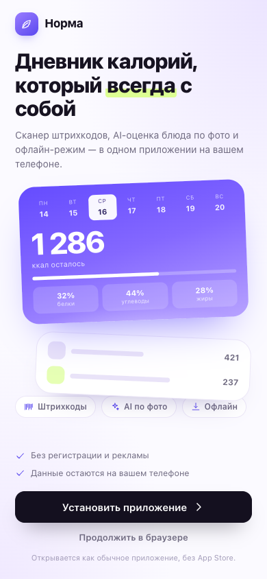
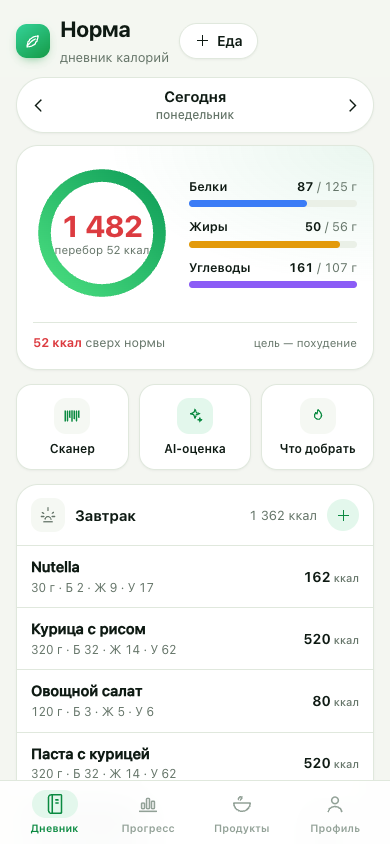
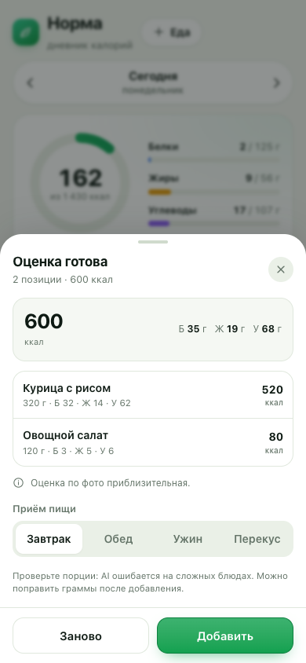

# Норма — дневник калорий

Дневник питания как PWA: считает норму калорий и БЖУ, добавляет продукты по штрихкоду, оценивает блюдо по фото или описанию с помощью Gemini. При первом открытии в браузере предлагает установить приложение на телефон, а в установленном виде работает офлайн и хранит данные на устройстве.

**Демо:** https://abaginskii.github.io/norm-calories/

<p align="center">
  
  
  
</p>

## Возможности

- **Экран установки** — в браузере сначала предложение поставить приложение; в установленном PWA сразу открывается дневник.
- **Дневник по дням** — новый главный экран с крупным итогом съеденных калорий, лентой записей и быстрым вводом текста.
- **Нутриенты** — отдельный экран с периодами 1 день / неделя / месяц / год / всё время, графиком БЖУ, клетчаткой и ориентировочным индексом рациона.
- **Сканер штрихкодов** — EAN-13, EAN-8, UPC, Code 128; продукт подтягивается из Open Food Facts.
- **AI-оценка** — фото тарелки или текстовое описание превращаются в блюда с граммовкой и КБЖУ.
- **«Что добрать»** — AI подсказывает, чем закрыть остаток калорий и белка.
- **База продуктов** — встроенные продукты, свои продукты и локальный кеш 745 товаров для России по штрихкоду. Для остальных кодов используется Open Food Facts онлайн.
- **Норма по формуле** Миффлина — Сан Жеора с учётом активности и цели; можно скорректировать вручную.
- **Вес** — запись, график, изменение за период, ИМТ.
- **Статистика** — калории за 7 и 30 дней, средние БЖУ, серия дней без пропусков.
- **Тёмная и светлая темы**, экспорт и импорт JSON.
- **Офлайн** — после первого открытия приложение работает без интернета, включая сканер.

## Установка на телефон

1. Откройте https://abaginskii.github.io/norm-calories/ в браузере телефона.
2. Нажмите «Установить приложение». Chrome покажет системный диалог; на iPhone откроется инструкция «Поделиться → На экран „Домой“».
3. После установки приложение открывается без адресной строки и показывает дневник сразу.

На экране установки есть ссылка «Продолжить в браузере» — на случай, если установка недоступна (например, Firefox на компьютере).

## Сканер штрихкодов

1. На дневнике нажмите «Сканер» или «+» → «Сканер».
2. Разрешите доступ к камере и наведите её на штрихкод.
3. Приложение найдёт продукт в [Open Food Facts](https://world.openfoodfacts.org/) и покажет КБЖУ на 100 г.
4. Укажите граммы и приём пищи — запись уйдёт в дневник.

Если продукта в базе нет, предложим создать свой: штрихкод сохранится вместе с продуктом, и в следующий раз он найдётся даже без интернета. Найденные продукты кешируются. Камера не нужна — штрихкод всегда можно ввести цифрами вручную.

Локальный кеш российских товаров — снимок наиболее популярных доступных записей [Open Food Facts](https://world.openfoodfacts.org/) (ODbL). Он не содержит все товары рынка: каталог Open Food Facts пополняется участниками, а для кода вне кеша требуется интернет. На карточке товара показываются клетчатка, Nutri-Score и NOVA, если источник их содержит. Эти оценки не заменяют проверку состава и этикетки.

## AI-помощник

Работает на вашем ключе Google Gemini. Ключ **не хранится в репозитории**: вы вставляете его в приложении (Профиль → AI-помощник), он лежит только в `localStorage` браузера и уходит напрямую в Google.

1. Получите ключ в [Google AI Studio](https://aistudio.google.com/app/apikey).
2. Профиль → AI-помощник → «Добавить ключ». Кнопка «Проверить» делает настоящий запрос к модели и показывает точную причину ошибки, если что-то не так.
3. На дневнике нажмите «AI-оценка»: фото или текст → оценка → «Добавить».
   Можно также отправить описание прямо из нижней капсулы на главной. При потере сети описание остаётся в поле; в офлайне оно сохраняется в очередь и отправится после восстановления связи.
4. «Что добрать» использует остаток дня и норму, чтобы предложить 3 варианта.

Модель по умолчанию — `gemini-2.5-flash`, её можно поменять. Ключ можно удалить в любой момент. У Gemini есть бесплатный лимит; запросы расходуют вашу квоту. Фото и описания отправляются в Google только когда вы сами запускаете оценку.

### Если ключ «не работает»

Приложение пробует несколько вариантов запроса (с `responseSchema` и без, с отключённым «размышлением» и без) и показывает реальный ответ Google в блоке «Технические детали». Самые частые причины:

- **«User location is not supported»** — Google блокирует Gemini из вашего региона. Поможет VPN или свой прокси (ниже).
- **«API key not valid»** — ключ скопирован не полностью или удалён.
- **«Generative Language API has not been used… disabled»** — в проекте не включён API: создайте новый ключ в AI Studio.
- **«RESOURCE_EXHAUSTED»** — исчерпан бесплатный лимит, подождите минуту.

### Прокси за 3 минуты (Cloudflare Workers, бесплатно)

Если Gemini недоступен из вашей страны, можно поставить простой прокси и указать его в настройках AI.

1. Откройте [dash.cloudflare.com](https://dash.cloudflare.com/) → Workers & Pages → Create → Worker.
2. Вставьте код и нажмите Deploy:

```js
const cors = {
  'access-control-allow-origin': '*',
  'access-control-allow-headers': '*',
  'access-control-allow-methods': 'GET,POST,OPTIONS',
};

export default {
  async fetch(request) {
    if (request.method === 'OPTIONS') {
      return new Response(null, { status: 204, headers: cors });
    }
    const url = new URL(request.url);
    const target = new URL(url.pathname + url.search, 'https://generativelanguage.googleapis.com');
    const response = await fetch(target, {
      method: request.method,
      headers: { 'content-type': request.headers.get('content-type') || 'application/json' },
      body: ['GET', 'HEAD'].includes(request.method) ? undefined : await request.text(),
    });
    const headers = new Headers(cors);
    headers.set('content-type', response.headers.get('content-type') || 'application/json');
    return new Response(response.body, { status: response.status, headers });
  },
};
```

3. Скопируйте адрес вида `https://имя.ваш-ник.workers.dev` (без `/v1beta`).
4. В приложении: Профиль → AI-помощник → поле «Прокси» → вставьте адрес → «Сохранить».

Ключ можно оставить пустым, если прокси подставляет свой. Код Worker'а — в репозитории в `docs/gemini-proxy.js`.

## Локальный запуск

Сборка не нужна — это статические файлы. Достаточно любого статического сервера:

```bash
git clone https://github.com/abaginskii/norm-calories.git
cd norm-calories
python3 -m http.server 8000
```

Откройте http://localhost:8000. Открывать `index.html` напрямую из файловой системы нельзя: ES-модули, service worker и камера требуют http(s).

## Структура

```
index.html            — разметка оболочки
styles.css            — дизайн-токены и все стили
manifest.webmanifest  — манифест PWA
sw.js                 — service worker (офлайн-кеш)
js/
  app.js              — роутер, вкладки, кнопка «+»
  store.js            — состояние, localStorage, даты, CRUD
  calc.js             — формулы нормы и БЖУ
  foods.js            — база продуктов
  ui.js               — иконки, нижние листы, тосты
  theme.js            — тема оформления
  pwa.js              — регистрация SW и установка
  scan.js             — камера, штрихкоды, Open Food Facts
  ai.js               — Gemini: фото, текст, подсказки, ключ и прокси
  addMenu.js          — меню добавления по кнопке «+»
  views/              — экраны: установка, онбординг, дневник, продукты, прогресс, профиль, выбор еды
data/ru-products.json — локальный кеш продуктов России из Open Food Facts
vendor/zxing.min.js   — декодер штрихкодов для браузеров без BarcodeDetector
docs/gemini-proxy.js  — код Cloudflare Worker для прокси
icons/                — иконки PWA
screenshots/          — скриншоты для манифеста и README
```

## Приватность

- Профиль, дневник, вес и продукты лежат в `localStorage` на вашем устройстве.
- Ключ Gemini и адрес прокси хранятся там же и не попадают в экспорт резервной копии.
- Сканер отправляет в Open Food Facts только номер штрихкода.
- AI отправляет в Google (или ваш прокси) только фото или текст, которые вы сами отправили на оценку.
- Нет аккаунтов, аналитики и собственного сервера.

## Ограничения

- База продуктов и Open Food Facts дают усреднённые значения: сверяйтесь с упаковкой.
- AI ошибается в весе и составе сложных блюд — проверяйте порции.
- Нет синхронизации между устройствами, только экспорт/импорт.
- Приложение не учитывает медицинские особенности; при заболеваниях сверьтесь с врачом.

## Технологии и лицензии

- Код приложения — MIT, см. [LICENSE](LICENSE).
- Данные о продуктах — [Open Food Facts](https://world.openfoodfacts.org/), лицензия ODbL.
- Декодирование штрихкодов — [ZXing](https://github.com/zxing-js/library), Apache-2.0 (текст лицензии в `vendor/ZXING-LICENSE.txt`).
- AI — Google Gemini API, условия и квоты Google.
