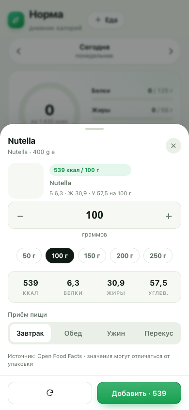

# Норма — дневник калорий

Дневник питания как PWA: считает норму калорий и БЖУ, добавляет продукты по штрихкоду, оценивает блюдо по фото или описанию с помощью Gemini. Работает офлайн, ставится на телефон с домашнего экрана, данные хранятся на устройстве.

**Демо:** https://abaginskii.github.io/norm-calories/

<p align="center">
  
  
  
</p>

## Возможности

- **Дневник по дням** — завтрак, обед, ужин и перекус, переход между днями.
- **Кольцо калорий и БЖУ** — сколько съедено, сколько осталось и как выполнены цели.
- **Сканер штрихкодов** — наведите камеру, продукт подтянется из Open Food Facts с КБЖУ на 100 г. EAN-13, EAN-8, UPC, Code 128.
- **AI-оценка** — фото тарелки или текстовое описание превращаются в блюда с граммовкой и КБЖУ, их можно сразу записать в дневник.
- **«Что добрать»** — AI подсказывает, чем закрыть остаток калорий и белка.
- **База продуктов** — 138 позиций на 100 г плюс свои продукты.
- **Поиск, недавние, избранное** — чтобы не искать одно и то же каждый день.
- **Норма по формуле** Миффлина — Сан Жеора с учётом активности и цели; можно скорректировать вручную.
- **Вес** — запись, график, изменение за период, ИМТ.
- **Статистика** — калории за 7 и 30 дней, средние БЖУ, серия дней без пропусков.
- **Тёмная и светлая темы**, экспорт и импорт JSON.
- **Офлайн** — после первого открытия приложение работает без интернета, включая сканер.

## Сканер штрихкодов

1. На дневнике нажмите «Сканер» (или «Сканер» в списке продуктов).
2. Разрешите доступ к камере и наведите её на штрихкод.
3. Приложение найдёт продукт в [Open Food Facts](https://world.openfoodfacts.org/) и покажет КБЖУ на 100 г.
4. Укажите граммы и приём пищи — запись уйдёт в дневник.

Если продукта в базе нет, предложим создать свой: штрихкод сохранится вместе с продуктом, и в следующий раз он найдётся даже без интернета. Найденные продукты кешируются на устройстве. Камера не нужна — штрихкод всегда можно ввести цифрами вручную.

## AI-помощник

Работает на вашем ключе Google Gemini. Ключ **не хранится в репозитории**: вы вставляете его в приложении (Профиль → AI-помощник), он лежит только в `localStorage` браузера и уходит напрямую в Google.

1. Получите ключ в [Google AI Studio](https://aistudio.google.com/app/apikey).
2. Профиль → AI-помощник → «Добавить ключ». Кнопка «Проверить» убедится, что ключ рабочий.
3. На дневнике нажмите «AI-оценка»: фото или текст → оценка → «Добавить».
4. «Что добрать» использует остаток дня и норму, чтобы предложить 3 варианта.

Модель по умолчанию — `gemini-2.5-flash`, её можно поменять в настройках. Ключ можно удалить в любой момент. У Gemini есть бесплатный лимит; запросы расходуют вашу квоту. Фото и описания отправляются в Google только когда вы сами запускаете оценку.

## Установка на телефон

**Android / Chrome:** меню браузера (⋮) → «Установить приложение» или «Добавить на главный экран».

**iPhone / Safari:** «Поделиться» → «На экран „Домой“».

После установки приложение открывается без адресной строки и работает офлайн.

## Локальный запуск

Сборка не нужна — это статические файлы. Достаточно любого статического сервера:

```bash
git clone https://github.com/abaginskii/norm-calories.git
cd norm-calories
python3 -m http.server 8000
```

Откройте http://localhost:8000. Открывать `index.html` напрямую из файловой системы нельзя: ES-модули, service worker и камера требуют http(s).

## Структура

```
index.html            — разметка оболочки
styles.css            — дизайн-токены и все стили
manifest.webmanifest  — манифест PWA
sw.js                 — service worker (офлайн-кеш)
js/
  app.js              — роутер и вкладки
  store.js            — состояние, localStorage, даты, CRUD
  calc.js             — формулы нормы и БЖУ
  foods.js            — база продуктов
  ui.js               — иконки, нижние листы, тосты, кольцо
  theme.js            — тема оформления
  pwa.js              — регистрация SW и установка
  scan.js             — камера, штрихкоды, Open Food Facts
  ai.js               — Gemini: фото, текст, подсказки, ключ
  views/              — экраны: онбординг, дневник, продукты, прогресс, профиль, выбор еды
vendor/zxing.min.js   — декодер штрихкодов для браузеров без BarcodeDetector
icons/                — иконки PWA
screenshots/          — скриншоты для манифеста и README
```

## Приватность

- Профиль, дневник, вес и продукты лежат в `localStorage` на вашем устройстве.
- Ключ Gemini хранится там же и не попадает в экспорт резервной копии.
- Сканер отправляет в Open Food Facts только номер штрихкода.
- AI отправляет в Google только фото или текст, которые вы сами отправили на оценку.
- Нет аккаунтов, аналитики и собственного сервера.

## Ограничения

- База продуктов и Open Food Facts дают усреднённые значения: сверяйтесь с упаковкой.
- AI ошибается в весе и составе сложных блюд — проверяйте порции.
- Нет синхронизации между устройствами, только экспорт/импорт.
- Приложение не учитывает медицинские особенности; при заболеваниях сверьтесь с врачом.

## Технологии и лицензии

- Код приложения — MIT, см. [LICENSE](LICENSE).
- Данные о продуктах — [Open Food Facts](https://world.openfoodfacts.org/), лицензия ODbL.
- Декодирование штрихкодов — [ZXing](https://github.com/zxing-js/library), Apache-2.0 (текст лицензии в `vendor/ZXING-LICENSE.txt`).
- AI — Google Gemini API, условия и квоты Google.
